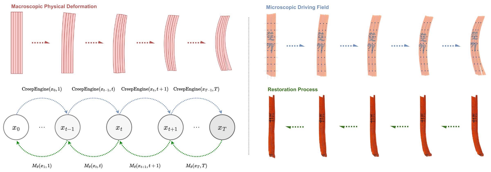

<h1 align="center">
Physics-Guided Multistep Deformation Reversal for Ancient Bamboo Slip Restoration
</h1>
<p align="center">
<strong>Qianqian Tang<sup>*</sup> · Jinchi Zhu<sup>*</sup> · Xiaolu Zhou · Yongchao Xu<sup>†</sup></strong><br>
Wuhan University<br>
<sup>*</sup> Equal contribution. <sup>†</sup> Corresponding author.
</p>


## Introduction

Ancient bamboo slips preserve historical texts that are essential to the study
of early civilizations. After excavation, changes in moisture and stress can
cause non-uniform shrinkage and complex warping, making inscriptions harder to
read and fragmented slips harder to rejoin. Physical restoration is slow and
requires delicate handling of fragile artifacts, with risks of breakage and ink
damage.

Digital restoration faces a central obstacle: **paired deformed and pristine
images are extremely scarce**. Excavated slips are already deformed, and their
original appearance is generally unavailable. Collecting reliable ground truth
for supervised learning is therefore difficult. Moreover, deformation is a
cumulative process governed by bamboo's fiber structure, viscoelastic behavior,
and moisture–stress interactions. Simple geometric transformations struggle to
capture these effects, while learning-based restoration without material priors
can distort fine strokes or introduce artifacts when correcting the shape.

We propose **PGDR (Physics-Guided Deformation Reversal)** to address these
challenges through physical modeling and progressive restoration. A forward
physical model generates deformation trajectories from straight slip images,
providing training supervision without naturally paired examples. A restoration
network then learns to predict physically meaningful, single-step displacement
corrections. Applying these corrections progressively aims to recover the
geometry while preserving textual details needed for reading and rejoining.

## Method Overview

<p align="center">

</p>

- **Forward physical deformation:** model fiber elongation, stress transfer, and
  moisture–stress coupling to synthesize progressive deformation trajectories
  and displacement supervision.
- **Multistep inverse restoration:** predict control-point displacement
  corrections and apply them step by step to restore the deformed image.

## Code structure

```text
data/          # image loading and datasets
models/        # control-point prediction network
physics/       # physical deformation model and forward simulation
training/      # displacement supervision
restoration/   # iterative restoration and output saving
utils/         # configuration, checkpoints, and shared utilities
scripts/       # training and restoration entry points
pic/           # method overview figure
docs/          # implementation notes
tests/         # integration tests
```

## Installation

```bash
conda env create -f environment.yml
conda activate pgdr
```

All commands below are run from the repository root.

## Dataset and Image Access

The paper uses images of the **Yunmeng Shuihudi Han bamboo slips**, including
2,000 straight slips (**1,800 for training and 200 for testing**) and a separate
set of **500 naturally deformed slips** for real-world evaluation. Deformed
training examples are generated by the physical model.

**Due to copyright restrictions, the bamboo-slip images and dataset are not
redistributed in this repository. For image access and research-use inquiries,
please email the corresponding author, [Yongchao Xu](mailto:yongchao.xu@whu.edu.cn),
at `yongchao.xu@whu.edu.cn`.**

Arrange the authorized images as follows:

```text
datasets/bamboo_slips/
  train/           # straight slips for training
  test/            # held-out straight slips
  real_deformed/   # naturally deformed slips for restoration
```

## Training and Restoration

### 1. Train the restoration network

```bash
python -m scripts.train \
  --dataset_root datasets/bamboo_slips \
  --output_dir outputs
```

Training logs and checkpoints are saved under `outputs/pgdr_<timestamp>/`.

### 2. Restore deformed images

Set the checkpoint path to the one produced by training:

```bash
MODEL_PATH="outputs/pgdr_<timestamp>/checkpoints/best_model.pt"
```

Pretrained weights are not bundled with this repository.

Restore a single image:

```bash
python -m scripts.sample \
  --model_path "$MODEL_PATH" \
  --input_path datasets/bamboo_slips/real_deformed/slip_0001.png \
  --output_dir outputs/restoration \
  --save_history
```

Or restore a directory:

```bash
python -m scripts.sample \
  --model_path "$MODEL_PATH" \
  --input_path datasets/bamboo_slips/real_deformed \
  --output_dir outputs/restoration
```

Results include restored images, input/output comparisons, and intermediate
states when `--save_history` is enabled.

For paper/code differences and checkpoint migration, see the
[implementation notes](docs/implementation_notes.md).

## Citation

If you use this work, please cite:

```bibtex
@artical{tang2026physics,
  title={Physics-Guided Multistep Deformation Reversal for Ancient Bamboo Slip Restoration},
  author={Tang, Qianqian and Zhu, Jinchi and Zhou, Xiaolu and Xu, Yongchao},
  booktitle={Proceedings of the IEEE/CVF Conference on Computer Vision and Pattern Recognition},
  pages={34061--34071},
  year={2026}
}
```
